  <!-- Banner Animado en Azul Clarito con Textura Gamer Nativa -->
  

    

  <!-- Badges de Estado y Perfil en Azul Celeste -->
  
  
  
  

---

### 👨‍💻 Sobre Mí / About Me

¡Hola! Soy **Jose Luis Pineda Barrera**, profesional y apasionado por la **Ingeniería en Multimedia**.

Mi enfoque principal está centrado en el **Desarrollo de Videojuegos**, la **Computación Gráfica 3D interactiva** y la **Inteligencia Artificial (Deep Learning)** aplicada a audio, visión y sistemas multimedia.

- 🎮 **Desarrollo de Videojuegos & 3D**: Diseño y programación de mecánicas, físicas, shaders y lógica de juego en **Unreal Engine** y **Unity** utilizando **C++** y **C#**, además de modelado y rigging en **Autodesk Maya**.
- 📐 **Computación Gráfica en la Web**: Implementación de álgebra y transformaciones matriciales 3D, proyecciones de cámara, mallas paramétricas y renderizado en tiempo real con **Three.js** y **WebGL**.
- 🧠 **Inteligencia Artificial en Multimedia**: Modelos de Deep Learning (CNNs, RNNs, LSTMs) para clasificación y análisis acústico (Melodía AI) y modelos de lenguaje natural con TensorFlow.
- 🐍 **Proyecto en Desarrollo Activo**: Actualmente programando un videojuego **Snake interactivo**, optimizando mecánicas de juego y visuales. ¡Pronto estaré subiendo nuevos repositorios y proyectos de videojuegos al perfil!

---

### 🛠️ Stack Tecnológico / Tech Stack

  

 

<b>📂 Tecnologías organizadas por área de especialidad</b>

 

| Área | Tecnologías |
| :--- | :--- |
| **Videojuegos & Motores 3D** | `Unreal Engine` `Unity` `C++` `C#` `Autodesk Maya` `Shaders & Físicas` |
| **Computación Gráfica Web** | `Three.js` `WebGL` `OrbitControls` `Transformaciones Matriciales 3D` |
| **Inteligencia Artificial & Datos** | `TensorFlow` `Keras` `Python` `Librosa (Audio)` `NumPy` `Pandas` `Jupyter` |
| **Desarrollo Web & Backend** | `JavaScript (ES6+)` `TypeScript` `Node.js` `Express` `Flask` `Prisma ORM` `Tailwind CSS` |
| **Herramientas & Pipeline** | `Git` `GitHub Actions` `Postman` `VS Code` `Sourcetree` |

---

### 🚀 Proyectos Destacados / Featured Projects

<table>
  <tr>
    <td width="50%">
      <h3 align="center">🐍 Snake Game (En Desarrollo)</h3>
      

        
        
      

      

        Videojuego clásico <b>Snake reimaginado con mecánicas interactivas y visuales modernas</b>. Proyecto actualmente en construcción y desarrollo continuo como parte de nuevas experiencias de juego.
      

      

        <b>¡Próximamente disponible en el perfil!</b>
      

    </td>
    <td width="50%">
      <h3 align="center">🎵 Melodía AI</h3>
      

        
        
      

      

        Plataforma interactiva para el <b>reconocimiento y clasificación de patrones acústicos e instrumentos musicales</b> utilizando espectrogramas y redes neuronales convolucionales y recurrentes. Proyecto UMNG.
      

      

        <a href="https://github.com/Jlpineda12/melodia-ai"><b>Ver Repositorio →</b></a>
      

    </td>
  </tr>
  <tr>
    <td width="50%">
      <h3 align="center">🎮 GameVault API</h3>
      

        
        
      

      

        <b>API RESTful y panel web</b> para la gestión y catalogación de biblioteca de videojuegos. Incluye filtrado por género/plataforma, tracking de estados de juego (Playing, Completed), estadísticas y migraciones con Prisma.
      

      

        <a href="https://github.com/Jlpineda12/gamevault-api"><b>Ver Repositorio →</b></a>
      

    </td>
    <td width="50%">
      <h3 align="center">✍️ NeuroText AI</h3>
      

        
        
      

      

        Sistema de <b>predicción de texto en tiempo real</b> mediante Deep Learning. Microservicio Flask con modelo Keras y cliente web interactivo con interfaz Glassmorphism en Tailwind CSS.
      

      

        <a href="https://github.com/Jlpineda12/neurotext-api"><b>Backend API</b></a> • 
        <a href="https://github.com/Jlpineda12/neurotext-web"><b>Frontend Web</b></a>
      

    </td>
  </tr>
  <tr>
    <td width="50%">
      <h3 align="center">📈 Time Series Forecasting</h3>
      

        
        
      

      

        Benchmarking experimental de <b>Redes Neuronales Recurrentes</b> (MLP vs. LSTM vs. Bi-LSTM con BatchNormalization) para modelado y predicción de series de tiempo complejas.
      

      

        <a href="https://github.com/Jlpineda12/deep-learning-time-series"><b>Ver Experimento →</b></a>
      

    </td>
    <td width="50%">
      <h3 align="center">📐 Three.js & 3D Graphics Lab</h3>
      

        
        
      

      

        Serie de 12 laboratorios prácticos de <b>Computación Gráfica</b>: transformaciones matriciales, proyecciones de cámara (ortográfica vs. perspectiva), constructores de poliedros y extrusión de mallas 3D.
      

      

        <a href="https://github.com/Jlpineda12/threejs-camera-projections"><b>Ver Laboratorios 3D →</b></a>
      

    </td>
  </tr>
</table>

---

### 📊 Actividad en Tiempo Real

  <!-- Tarjeta de Racha de Commits -->
  

---

### 🎮 Juego de la Serpiente / Contribution Activity

  <!-- Snake Animation alojado localmente en el repositorio: Carga 100% garantizada e instantánea -->
  <picture>
    <source media="(prefers-color-scheme: dark)" srcset="./assets/snake-dark.svg">
    <source media="(prefers-color-scheme: light)" srcset="./assets/snake-light.svg">
    
  </picture>

---

### 📬 Conectemos / Contact

  
  &nbsp;&nbsp;
  

