<div align="center">


<a href="https://github.com/Jlpineda12"></a>
<a href="https://github.com/Jlpineda12?tab=followers"></a>
<a href="https://jlpineda12.github.io/arcade-station/"></a>

</div>


```js
const jose = {
  rol:        "Ingeniero en Multimedia · Colombia 🇨🇴",
  construyo:  ["juegos web retro", "experiencias 3D", "IA aplicada a audio y lenguaje"],
  enfoque:    "Vanilla JS, Canvas y Web Audio API: cero dependencias, todo hecho a mano",
  motores:    ["Unity (C#)", "Unreal Engine (C++)", "Three.js / WebGL"],
  ahora:      "Arcade Station → 5 juegos retro con música chiptune procedural",
};
```

<details>
<summary><b>📂 Ver más sobre mí</b> (clic para abrir)</summary>
<br>

- 🎮 **Videojuegos y 3D** — Creador de [**LingoPulse**](https://github.com/Jlpineda12/lingopulse), simulador de inglés gamificado con mascota 3D en tiempo real (`expo-gl` / Three.js). Mecánicas y shaders en **Unreal** y **Unity**, modelado en **Autodesk Maya**.
- 📐 **Computación gráfica** — Matemática espacial 3D, transformaciones matriciales, proyecciones de cámara y renderizado WebGL con **Three.js**.
- 🧠 **IA en multimedia** — Redes CNN, RNN y LSTM para reconocimiento acústico ([Melodía AI](https://github.com/Jlpineda12/melodia-ai)) y predicción de lenguaje con TensorFlow.
- 🕹️ **Web retro** — Todos mis juegos arcade corren en el navegador sin frameworks ni archivos de audio: la música se sintetiza en tiempo real.

</details>


<p align="center"><b>Cada cartucho es jugable.</b> Haz clic en uno para encenderlo en tu navegador 👇</p>

<div align="center">
  <a href="https://jlpineda12.github.io/arcade-station/"></a>
  <a href="https://jlpineda12.github.io/pixel-snake-arcade/">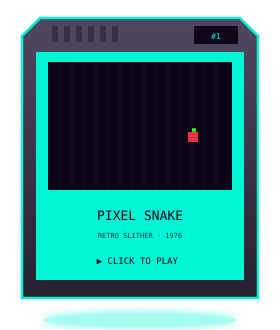</a>
  <a href="https://jlpineda12.github.io/pixel-combat-arcade/">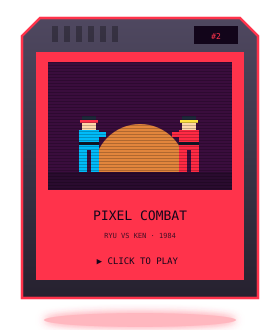</a>
  <br/>
  <a href="https://jlpineda12.github.io/pixel-space-arcade/">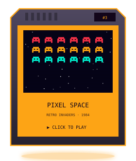</a>
  <a href="https://jlpineda12.github.io/pixel-breaker-arcade/">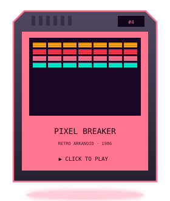</a>
  <a href="https://jlpineda12.github.io/pixel-maze-arcade/">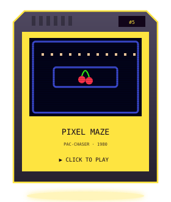</a>
</div>

<details>
<summary><b>🔧 ¿Cómo están hechos?</b> (clic para abrir)</summary>
<br>

| | Detalle |
| :-- | :-- |
| 🎨 **Gráficos** | Canvas 2D a 60 FPS, pantalla CRT con scanlines, escenario synthwave animado |
| 🎵 **Audio** | Web Audio API: osciladores + ruido → música chiptune y efectos generados en vivo |
| 📱 **Móvil** | Joystick y botones táctiles que aparecen solo en el celular |
| 🧪 **Calidad** | 237 pruebas automatizadas; cada push corre las pruebas antes de publicar |
| 📦 **Dependencias** | Cero. Abre `index.html` con cualquier servidor estático y listo |

Código: [arcade-station](https://github.com/Jlpineda12/arcade-station) · [snake](https://github.com/Jlpineda12/pixel-snake-arcade) · [combat](https://github.com/Jlpineda12/pixel-combat-arcade) · [space](https://github.com/Jlpineda12/pixel-space-arcade) · [breaker](https://github.com/Jlpineda12/pixel-breaker-arcade) · [maze](https://github.com/Jlpineda12/pixel-maze-arcade)

</details>


<div align="center">
  <a href="https://github.com/Jlpineda12/lingopulse">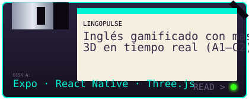</a>
  <a href="https://github.com/Jlpineda12/melodia-ai">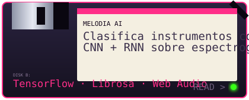</a>
  <a href="https://github.com/Jlpineda12/neurotext-api">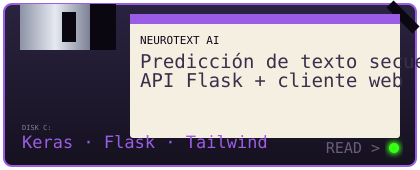</a>
  <a href="https://github.com/Jlpineda12/gamevault-api">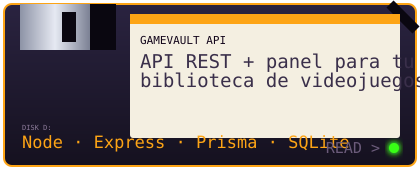</a>
  <a href="https://github.com/Jlpineda12/deep-learning-time-series">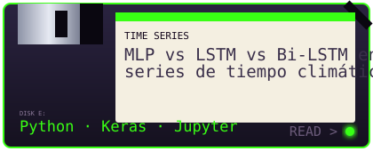</a>
  <a href="https://github.com/Jlpineda12/threejs-camera-projections"></a>
</div>

<details>
<summary><b>💾 Ver los 12 talleres de Three.js</b> (clic para abrir)</summary>
<br>

| # | Taller | Tema |
| :-: | :-- | :-- |
| 01 | [threejs-transformations-intro](https://github.com/Jlpineda12/threejs-transformations-intro) | Primeras transformaciones |
| 02 | [threejs-3d-cubes](https://github.com/Jlpineda12/threejs-3d-cubes) | Cubos 3D |
| 03 | [threejs-pyramid-matrices](https://github.com/Jlpineda12/threejs-pyramid-matrices) | Pirámides con matrices |
| 04 | [threejs-transform-math](https://github.com/Jlpineda12/threejs-transform-math) | Matemática de transformaciones |
| 05 | [threejs-orbitcontrols-lab](https://github.com/Jlpineda12/threejs-orbitcontrols-lab) | OrbitControls |
| 06 | [threejs-wireframe-cubes](https://github.com/Jlpineda12/threejs-wireframe-cubes) | Wireframes |
| 07 | [threejs-keyboard-animation](https://github.com/Jlpineda12/threejs-keyboard-animation) | Animación con teclado |
| 08 | [threejs-geometry-synthesis](https://github.com/Jlpineda12/threejs-geometry-synthesis) | Síntesis de geometría |
| 09 | [threejs-camera-projections](https://github.com/Jlpineda12/threejs-camera-projections) | Proyecciones de cámara |
| 10 | [threejs-polyhedra-builder](https://github.com/Jlpineda12/threejs-polyhedra-builder) | Constructor de poliedros |
| 11 | [threejs-prism-generator](https://github.com/Jlpineda12/threejs-prism-generator) | Generador de prismas |
| 12 | [threejs-truncated-mesh-generator](https://github.com/Jlpineda12/threejs-truncated-mesh-generator) | Mallas truncadas |

</details>


<div align="center">
  
</div>

<details>
<summary><b>🗂️ Ver stack por área</b> (clic para abrir)</summary>
<br>

| Área | Tecnologías |
| :-- | :-- |
| **Web & Frontend** | `HTML` `CSS` `JavaScript (ES6+)` `TypeScript` `React` `Tailwind CSS` `Canvas 2D` `Web Audio API` |
| **Backend** | `Node.js` `Express` `Flask` `Prisma ORM` `Supabase` `SQLite` |
| **Motores, móvil & 3D** | `Unity (C#)` `Unreal Engine (C++)` `Three.js` `WebGL` `React Native` `Expo` `Autodesk Maya` |
| **Inteligencia artificial** | `Python` `TensorFlow` `Keras` `Librosa` `NumPy` `Pandas` `Jupyter` |
| **Herramientas** | `Git` `GitHub Actions` `GitHub Pages` `Postman` `VS Code` |

</details>


<div align="center">
  <a href="https://github.com/Jlpineda12"></a>
  <a href="https://github.com/Jlpineda12"></a>
</div>

<br/>

<div align="center">
  
</div>


<div align="center">

¿Juegos web, experiencias 3D o IA multimedia? **Hablemos.**

<a href="mailto:joseluispineda177@gmail.com"></a>
<a href="https://github.com/Jlpineda12"></a>
<a href="https://jlpineda12.github.io/arcade-station/"></a>

<br/><br/>

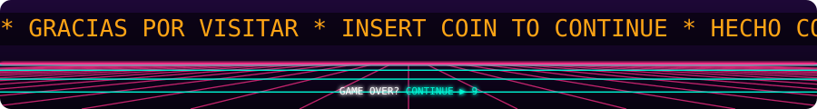

<sub>Los gráficos de este perfil son SVG animados generados con <a href="./scripts/generate_assets.py"><code>scripts/generate_assets.py</code></a>.</sub>

</div>
