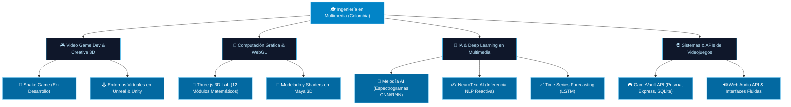

  <!-- Banner Animado en Azul Clarito con Textura Gamer y Texto Dinámico -->
  

    

  <!-- Barra de Navegación Rápida -->
  

    <a href="#-sobre-mí--about-me"><b>Sobre Mí</b></a> • 
    <a href="#-ecosistema-multimedia-interconectado"><b>Ecosistema</b></a> • 
    <a href="#-proyectos-destacados--featured-projects"><b>Proyectos</b></a> • 
    <a href="#-stack-tecnológico--tech-stack"><b>Stack Tecnológico</b></a> • 
    <a href="#-juego-de-la-serpiente--contribution-activity"><b>Snake Game</b></a> • 
    <a href="#-contacto--get-in-touch"><b>Contacto</b></a>
  

  <!-- Badges de Estado y Perfil en Azul Celeste -->
  
  
  
  

---

###  Sobre Mí / About Me

¡Hola! Soy **Jose Luis Pineda Barrera**, profesional y desarrollador en **Ingeniería en Multimedia en Colombia 🇨🇴**.

Mi trabajo une la **creatividad audiovisual**, el **desarrollo de videojuegos** y la **ingeniería de software avanzada**: entiendo los videojuegos y las aplicaciones interactivas no como piezas aisladas, sino como un **ecosistema conectado** donde los gráficos 3D en tiempo real, las mecánicas lógicas y la Inteligencia Artificial cooperan para crear experiencias memorables.

-  **Desarrollo de Videojuegos & 3D**: Programación de mecánicas, físicas, shaders y lógica en **Unreal Engine** y **Unity** con **C++** y **C#**, además de modelado, texturizado y rigging en **Autodesk Maya**.
-  **Computación Gráfica**: Dominio de la matemática espacial 3D, transformaciones matriciales, proyecciones de cámara y renderizado en tiempo real en la web con **Three.js** y **WebGL**.
-  **Inteligencia Artificial en Multimedia**: Modelos de Deep Learning (CNNs, RNNs, LSTMs) para reconocimiento acústico y espectrogramas sonoros (Melodía AI) y modelos de inferencia secuencial de texto.
-  **Proyecto en Desarrollo Activo**: Actualmente construyendo una versión moderna e interactiva del **videojuego Snake**, expandiendo mecánicas de juego y visuales. ¡Próximamente se integrarán nuevas entregas de videojuegos en el perfil!

---

###  Ecosistema Multimedia Interconectado

Todo mi trabajo en GitHub responde a una visión holística de la Multimedia interactiva:

---

###  Proyectos Destacados / Featured Projects

<table>
  <tr>
    <td width="50%">
      <h3 align="center"> Snake Game (En Desarrollo)</h3>
      

        
        
      

      

        <b>Reimaginación interactiva del clásico juego Snake</b>. Diseñado para explorar mecánicas modernas de control, respuesta inmediata y estética arcade pulida. Proyecto central de la fase actual de producción.
      

      

        <b>🚀 ¡Próximamente disponible en el perfil!</b>
      

    </td>
    <td width="50%">
      <h3 align="center"> Melodía AI</h3>
      

        
        
      

      

        <b>Plataforma interactiva de clasificación de audio e instrumentos musicales</b>. Combina la extracción de espectrogramas acústicos mediante Librosa y modelos neuronales híbridos CNN + RNN con Web Audio API en tiempo real.
      

      

        <a href="https://github.com/Jlpineda12/melodia-ai"><b>Explorar Melodía AI →</b></a>
      

    </td>
  </tr>
  <tr>
    <td width="50%">
      <h3 align="center"> GameVault API</h3>
      

        
        
      

      

        <b>API RESTful y panel web</b> para la gestión, catalogación y metadata de bibliotecas personales de videojuegos. Incluye filtrado por género, estados de juego en tiempo real (Playing, Completed), métricas y base de datos relacional.
      

      

        <a href="https://github.com/Jlpineda12/gamevault-api"><b>Explorar GameVault API →</b></a>
      

    </td>
    <td width="50%">
      <h3 align="center"> NeuroText AI</h3>
      

        
        
      

      

        <b>Sistema de predicción de secuencias lingüísticas en tiempo real</b>. Microservicio backend en Flask sirviendo un modelo Keras tokenizado y conectado a un cliente web con estética Glassmorphism en Tailwind CSS.
      

      

        <a href="https://github.com/Jlpineda12/neurotext-api"><b>Backend API</b></a> • 
        <a href="https://github.com/Jlpineda12/neurotext-web"><b>Frontend Web</b></a>
      

    </td>
  </tr>
  <tr>
    <td width="50%">
      <h3 align="center"> Time Series Forecasting</h3>
      

        
        
      

      

        <b>Benchmarking riguroso de redes neuronales recurrentes</b> para el pronóstico de datos secuenciales multivariables. Comparativa experimental de rendimiento y métricas MAE entre MLP, LSTM estándar y Bi-LSTM optimizado.
      

      

        <a href="https://github.com/Jlpineda12/deep-learning-time-series"><b>Ver Experimento →</b></a>
      

    </td>
    <td width="50%">
      <h3 align="center"> Three.js 3D Graphics Lab</h3>
      

        
        
      

      

        <b>Colección de 12 laboratorios matemáticos y visuales de gráficos 3D</b>: álgebra matricial afín, proyecciones de cámara (ortográfica vs. perspectiva), constructores de poliedros paramétricos y algoritmos de extrusión WebGL.
      

      

        <a href="https://github.com/Jlpineda12/threejs-camera-projections"><b>Ver Laboratorios 3D →</b></a>
      

    </td>
  </tr>
</table>

---

###  Stack Tecnológico / Tech Stack

  

 

<b>📂 Tecnologías organizadas y conectadas por especialidad</b>

 

| Dimensión Multimedia | Tecnologías y Herramientas |
| :--- | :--- |
| **🎮 Motores de Videojuegos & 3D** | `Unreal Engine` `Unity` `C++` `C#` `Autodesk Maya` `Shaders & Físicas` |
| **📐 Computación Gráfica Web** | `Three.js` `WebGL` `OrbitControls` `Transformaciones Matriciales 3D` |
| **🧠 Inteligencia Artificial Aplicada** | `TensorFlow` `Keras` `Python` `Librosa (Audio)` `NumPy` `Pandas` `Jupyter` |
| **🌐 Arquitectura Web & APIs** | `JavaScript (ES6+)` `TypeScript` `Node.js` `Express` `Flask` `Prisma ORM` `Tailwind CSS` |
| **🛠️ Pipeline & Control de Versiones** | `Git` `GitHub Actions` `Postman` `VS Code` `Sourcetree` |

---

###  Actividad en Tiempo Real

  <!-- Tarjeta de Racha de Commits -->
  

---

###  Juego de la Serpiente / Contribution Activity

  
<i>La actividad en GitHub devorada por la serpiente del juego:</i>

  <!-- Snake Animation local: Carga instantánea y fluida -->
  <picture>
    <source media="(prefers-color-scheme: dark)" srcset="./assets/snake-dark.svg">
    <source media="(prefers-color-scheme: light)" srcset="./assets/snake-light.svg">
    
  </picture>

---

### 📬 Contacto / Get In Touch

  
¿Interesado en colaborar en desarrollo de videojuegos, gráficos 3D o proyectos de IA multimedia?

  
  &nbsp;&nbsp;
  

